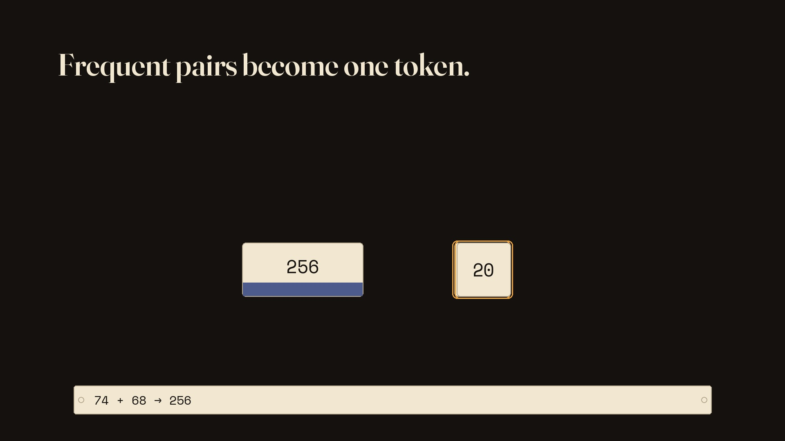
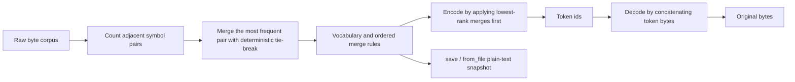

# byte-bpe

A compact, dependency-free byte-level BPE (Byte Pair Encoding) tokenizer for Rust. It trains a vocabulary from raw bytes, encodes byte slices into token ids, decodes those ids back into bytes, and saves trained tokenizers in a small plain-text format. It is built for Rust developers who want a readable, auditable tokenizer baseline and a benchmark whose acceptance criteria were fixed before the numbers were measured.

[](https://github.com/ibraramin/bpe-rs/actions/workflows/ci.yml)
[](https://crates.io/crates/byte-bpe)
[](https://docs.rs/byte-bpe)
[](LICENSE)
[](https://www.rust-lang.org/)

> Naming note: this package is published as `byte-bpe` because `bpe-rs` was already taken on crates.io (verified 2026-11-25). The repository and GitHub project remain `bpe-rs`.

[](docs/assets/brag.mp4)

https://github.com/user-attachments/assets/8cb4eb69-2b0b-46af-8ac2-33b4feda04b6


## Highlights

- Pure Rust with no runtime dependencies. Trains, encodes, decodes, and serializes with the standard library alone.
- True byte-level alphabet: ids `0..=255` always denote the single byte of the same value, so every possible byte string is representable and `decode(encode(bytes)) == bytes` holds even for bytes absent from the training corpus.
- Deterministic training. Adjacent pairs are counted over the corpus, the most frequent pair is merged, and ties break on the lowest pair of ids. The same corpus and vocabulary size always yield the same vocabulary and merge rules.
- Priority-ordered encoding. Each learned merge carries a rank, and encoding applies the lowest-rank applicable merge to all non-overlapping occurrences at once.
- Plain-text persistence. `save` and `from_file` round-trip the vocabulary and merge rules through a documented, human-readable format with validation on load.
- Reproducible benchmarking. Two Criterion groups, a frozen corpus with a fixed SHA-256, and a pre-registered SIMD gate whose outcome is published with the raw Criterion logs.
- Property-tested correctness. Integration tests plus proptest cases over arbitrary byte strings, with `cargo test` and `cargo test --all-features` both passing.

## Install

```sh
cargo add byte-bpe
```

The crate is published at <https://crates.io/crates/byte-bpe>, with API docs at <https://docs.rs/byte-bpe>.

## Quick start

Train on any byte corpus, encode, decode, and persist the result:

```rust
use byte_bpe::Tokenizer;

fn main() {
    // Train on any byte corpus. The base alphabet is all 256 byte values.
    let corpus = b"the quick brown fox jumps over the lazy dog; \
                   the quick brown fox jumps over the lazy dog;";
    let tokenizer = Tokenizer::train(corpus, 512);

    let ids = tokenizer.encode(b"quick brown fox");
    let bytes = tokenizer.decode(&ids).expect("encode output always decodes");
    assert_eq!(bytes, b"quick brown fox");

    // Persist and reload a trained tokenizer.
    let path = std::env::temp_dir().join("byte-bpe-example.bin");
    tokenizer.save(&path).expect("save");
    let reloaded = Tokenizer::from_file(&path).expect("load");
    assert_eq!(reloaded.encode(b"quick brown fox"), ids);
    let _ = std::fs::remove_file(&path);
}
```

## API at a glance

| Method | Purpose |
| --- | --- |
| `Tokenizer::train(corpus: &[u8], vocab_size: usize) -> Tokenizer` | Learn a vocabulary and ordered merge rules. Requests below 256 are treated as 256. |
| `encode(&self, input: &[u8]) -> Vec<u32>` | Encode bytes using the learned merges. This is the default, single-threaded path. |
| `decode(&self, ids: &[u32]) -> Result<Vec<u8>, String>` | Rebuild bytes, returning an error for out-of-range ids. |
| `save(&self, path: &Path) -> io::Result<()>` | Write the vocabulary and merges as plain text. |
| `Tokenizer::from_file(path: &Path) -> io::Result<Tokenizer>` | Load a saved tokenizer, returning `InvalidData` for a malformed file. |
| `vocab_size(&self) -> usize` | Number of tokens in the vocabulary. |
| `encode_simd(&self, input: &[u8]) -> Vec<u32>` | Optional SSE2 encode path on x86_64, available behind the `simd` feature and falling back to `encode` elsewhere. |

A minimal use of the encoding API:

```rust
use byte_bpe::Tokenizer;

let tokenizer = Tokenizer::train(b"the quick brown fox", 300);
assert!(tokenizer.vocab_size() >= 256);
let ids = tokenizer.encode(b"the fox");
assert_eq!(tokenizer.decode(&ids).unwrap(), b"the fox");
```

## Architecture



- **Byte alphabet.** The initial vocabulary is all 256 possible byte values, so encoding can never fail and the byte round-trip is exact.
- **Training.** Each iteration counts adjacent symbol pairs, picks the most frequent pair (lowest ids win a tie), appends the concatenation as a new token with the next free id, and rewrites the corpus. Iteration stops when the vocabulary reaches `vocab_size` or no adjacent pairs remain.
- **Encoding.** A rank table maps each merge pair to its priority. The lowest-rank applicable merge is applied to all non-overlapping occurrences each pass, which makes the result deterministic.
- **Serialization.** `save` writes one line with the vocabulary size `N`, followed by exactly `N` lines of lowercase hexadecimal token bytes (a blank line denotes empty bytes), then one `LEFT RIGHT` line per merge using decimal token ids in priority order. `from_file` parses that layout and validates that every merge matches the token it creates.
- **Optional SIMD path.** With the `simd` feature on x86_64, `encode_simd` scans four merge candidates per SSE2 iteration over a flat O(1) rank table and returns ids identical to the reference encoder. On other targets it delegates to `encode`.

## Benchmarks

Two Criterion groups are defined in `benches/bpe_bench.rs`. All authoritative figures below come from `results/benchmark-results.md` and were measured on one host: AMD Ryzen 7 6800HS Creator Edition, x86_64, 16 logical CPUs, rustc 1.92.0.

The pre-registered group `encode_realistic` encodes a frozen corpus, `results/corpus.txt` (50,020 bytes, SHA-256 `e5266287e4696c3cb724a47ad8de7a86e7fe4eec5fea7e49becc2ed8ee577283`), embedded with `include_bytes!` so the input cannot drift. Both arms see identical bytes and `VOCAB_SIZE = 512`: `scalar` is the unchanged reference `encode`, and `simd` is `encode_simd` behind the opt-in feature.

Three definitive `cargo bench --all-features` runs on the final code (2026-11-26, exit 0 each) produced these Criterion console means in MiB/s, with 95% confidence intervals in brackets:

| Run | scalar mean [95% CI] | SIMD mean [95% CI] | SIMD speedup | CIs disjoint |
| --- | --- | --- | --- | --- |
| 1 | 0.5001 [0.4744, 0.5241] | 1.3453 [1.2871, 1.4015] | 2.69x | yes |
| 2 | 0.6202 [0.6129, 0.6271] | 1.5786 [1.5665, 1.5882] | 2.55x | yes |
| 3 | 0.6445 [0.6422, 0.6470] | 1.4376 [1.4320, 1.4426] | 2.23x | yes |

**Pre-registered gate.** Before any definitive run, the rule required at least three full runs, a 15% or greater mean speedup, a 10% or greater median speedup, the SIMD 95% CI lower bound strictly above the scalar upper bound in every run, and correctness gates covering byte-identical ids, decode identity, and save/load. All gates were met in all three runs, so the `simd` feature was kept as opt-in (`default = []`).

**Median speedup.** Criterion's console default is the mean, while the pre-registered gate is defined on the median. Only the final run archived median JSON: scalar 0.6454 MiB/s [0.6443, 0.6475] and SIMD 1.4447 MiB/s [1.4385, 1.4468], a 2.238x median speedup with disjoint CIs. Runs 1 and 2 archived only console logs, so their medians are not claimed separately. Both the mean gate and the archived median gate are satisfied.

**Correctness gates.** `cargo test --all-features` (including four SIMD tests, among them proptest over 0..=512 arbitrary bytes) and `cargo test` both exit 0. Raw Criterion console logs and JSON are preserved in `results/raw-criterion/`.

The second group, `encode_throughput`, compares byte-bpe against HuggingFace `tokenizers` 0.21 BPE on a deterministic ASCII fixture of 235,520 bytes with a matched vocabulary target of 512, using `BPE::default()` and a `BpeTrainer` seeded with all 256 byte values as single-character alphabet entries and no normalizer, pre-tokenizer, decoder, or special tokens. Its historical console figures were not archived in a results artifact, so no numbers from that group are quoted here. Its methodology and the two groups must not be merged into one claim.

A thread-parallel candidate was reverted because it measured 0.99x, 1.02x, and 0.89x against scalar with overlapping CIs in three code-stable runs. No parallel dependency or parallel encode method remains in the published crate.

## Demo

An abstract walk through the byte alphabet, merge rules, exact round-trip and the pre-registered SIMD gate in the video above. The showcase above is a terminal recording of `examples/demo.rs`.

## Scope and limitations

- No pretrained vocabulary is bundled. Train on your own corpus with `Tokenizer::train` or load a previously saved file with `Tokenizer::from_file`.
- Training is corpus dependent. Merge rules reflect only the bytes and pair frequencies of the text used to train, so token counts and encode quality vary across domains.
- The default encoder is single-threaded. The `simd` feature is opt-in and is not part of the published `v0.1.1` crate.
- The measured SIMD gain couples SSE2 with a flat O(1) rank table replacing a `HashMap`. No scalar-plus-table control was pre-registered, so the win is not attributable to SSE2 instructions alone.
- The `encode_throughput` fixture is synthetic ASCII, not a downstream dataset, and must not be combined with `encode_realistic`. The `encode_realistic` corpus is real prose mixed with Markdown and code, not a natural-language book excerpt. The HuggingFace arm uses its own BPE training procedure over Unicode scalar values, so the two vocabularies are not token-for-token identical.
- All measurements come from one local machine and depend on CPU, compiler version, and corpus size. No WebAssembly target is shipped.

## License

MIT. See [LICENSE](LICENSE).

## Links

- Crate: <https://crates.io/crates/byte-bpe>
- API docs: <https://docs.rs/byte-bpe>
- Source and tagged releases: <https://github.com/ibraramin/bpe-rs>
- Benchmark methodology and raw data: [benchmark-results.md](results/benchmark-results.md), [preregistration.md](results/preregistration.md), and [raw-criterion/](results/raw-criterion/)
