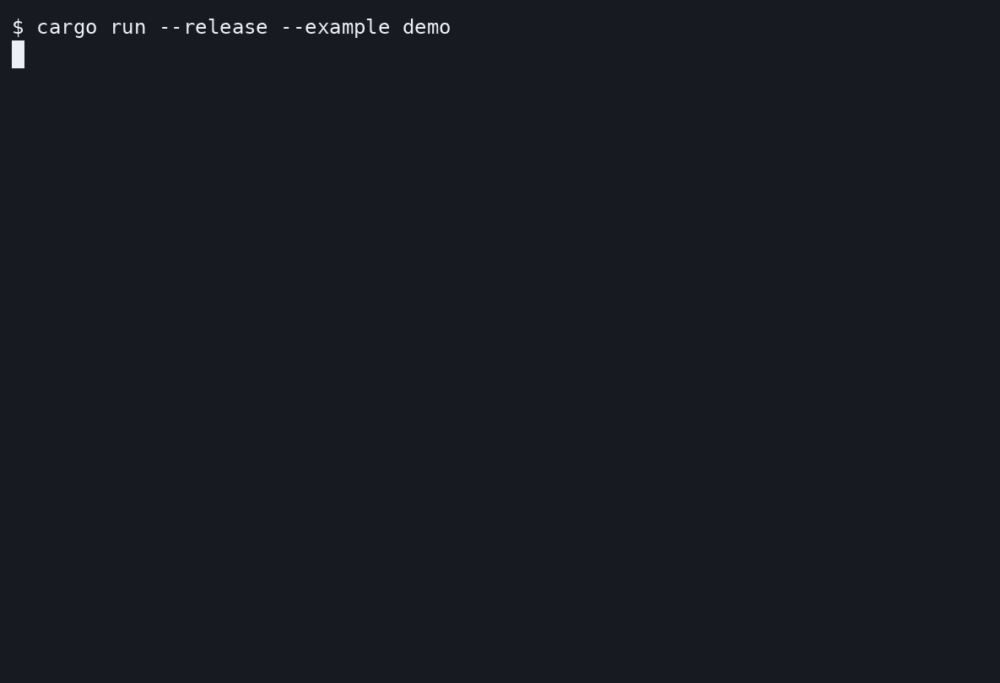

# byte-bpe

A from-scratch byte-level BPE tokenizer for Rust, benchmarked honestly against HuggingFace `tokenizers`.

[](https://github.com/ibraramin/bpe-rs/actions/workflows/ci.yml)   

> Naming note: this package is published as `byte-bpe` because `bpe-rs` was already taken on crates.io (verified and recorded on 2026-11-25). The repository directory and GitHub project remain `bpe-rs`.

## Install

```sh
cargo add byte-bpe
```

Crates.io: <https://crates.io/crates/byte-bpe>
Repository: `bpe-rs`

## Quick start

```rust
use byte_bpe::Tokenizer;

fn main() {
    // Train on any byte corpus. The base alphabet is all 256 byte values.
    let corpus = b"the quick brown fox jumps over the lazy dog; \
                   the quick brown fox jumps over the lazy dog;";
    let tokenizer = Tokenizer::train(corpus, 512);

    let ids = tokenizer.encode(b"quick brown fox");
    let bytes = tokenizer.decode(&ids).expect("encode output always decodes");
    assert_eq!(bytes, b"quick brown fox");

    // Persist and reload a trained tokenizer.
    let path = std::env::temp_dir().join("byte-bpe-example.bin");
    tokenizer.save(&path).expect("save");
    let reloaded = Tokenizer::from_file(&path).expect("load");
    assert_eq!(reloaded.encode(b"quick brown fox"), ids);
    let _ = std::fs::remove_file(&path);
}
```

## Demo



A 24-second terminal recording showing train, encode/decode, `cargo test` and a Criterion run. Source: `examples/demo.rs`.

## Architecture notes

- Byte-level alphabet: the initial vocabulary contains all 256 possible byte values, so every byte string is representable and `decode(encode(bytes))` is the identity.
- Merge priority: training counts adjacent symbol pairs over the corpus and repeatedly merges the most frequent pair, with deterministic tie breaking, until the requested `vocab_size` is reached. Learned merge rules carry an explicit priority and encoding applies them in that order.
- Serialization: `save` writes a plain-text snapshot. The first line is the vocabulary size `N` as a decimal integer, followed by exactly `N` lines holding each token's bytes as lowercase hexadecimal (a blank line denotes empty bytes), then one `LEFT RIGHT` line per merge rule using decimal token ids in priority order. `from_file` parses that layout and rebuilds the exact same id space, reporting `InvalidData` on a malformed file.
- No runtime dependencies are needed to encode once a tokenizer is trained.

## Benchmarks

Run with `cargo bench`. Both rows use the identical deterministic in-memory ASCII corpus generated in `benches/bpe_bench.rs` and the same target vocabulary size. Criterion reports throughput in MiB/s; the values below are the median of 10 samples with the 95% confidence interval in parentheses.

| Method | MiB/s | corpus | vocab | hardware |
|---|---|---|---|---|
| `byte-bpe` encode | 1.372 (1.366 to 1.377) | fixed in-memory ASCII, 235,520 bytes (512 repetitions of one paragraph) | 512 | AMD Ryzen 7 6800HS Creator Edition, x86_64, 16 logical CPUs, stable rustc 1.92.0 |
| HuggingFace `tokenizers` BPE encode | 7.806 (7.710 to 7.892) | same bytes as above | 512 | AMD Ryzen 7 6800HS Creator Edition, x86_64, 16 logical CPUs, stable rustc 1.92.0 |

Recorded 2026-11-25 with `cargo bench --bench bpe_bench -- --warm-up-time 1 --measurement-time 3 --sample-size 10` (a short run; the default Criterion settings give tighter intervals). HuggingFace is about 5.7 times faster. That gap is expected for a dependency-free reference implementation that rebuilds its merge-rank map and rescans the whole sequence on each encode pass. It is reported as measured rather than tuned away; see Limitations before comparing these numbers.

### Comparison settings

The HuggingFace row uses `tokenizers` 0.21 with these exact settings, documented in `benches/bpe_bench.rs`:

- model: `tokenizers::models::bpe::BPE::default()`
- trainer: `BpeTrainer::builder().vocab_size(512).initial_alphabet((0u8..=255).map(char::from).collect::<HashSet<char>>()).show_progress(false).build()`
- special tokens: none
- normalizer, pre-tokenizer and decoder: none, plain BPE over Unicode scalar values
- training: the corpus is fed as whitespace separated words through `Trainer::feed`, then `Trainer::train` fits the BPE model

Version note: `tokenizers` 0.21 removed the older `Tokenizer::train_from_iterator` method, and the dynamically typed `tokenizers::Tokenizer` uses an internal `ModelWrapper`. The benchmark therefore trains the `BPE` model directly through the `Trainer` trait and wraps the trained model in a `Tokenizer`. Both sides see the same corpus bytes and the same vocabulary target.

## Limitations

- No pretrained vocabulary is shipped. You must train on your own corpus with `Tokenizer::train` or load a previously saved file with `Tokenizer::from_file`.
- Training is corpus dependent. Merge rules only reflect the bytes and pair frequencies of the text used to train, so encode quality and token counts will vary across domains.
- Benchmark methodology caveats: the corpus is synthetic ASCII text, not a real downstream dataset. The HuggingFace model uses its own BPE training procedure and an alphabet of byte values represented as Unicode scalar values, so vocabularies are not token for token identical. Encoding is measured single threaded with `encode(text, false)` on the HuggingFace side and with the equivalent byte-only `encode` on our side. Results depend on CPU, compiler version, and corpus size. Numbers are not filled in until an actual Criterion run is recorded.
- WebAssembly is not included in this milestone. A wasm target is a possible future addition.

## Project status

- Session design: `docs/sessions/phase-2/ai.md`
- Built and locally verified 2026-11-25: core library, proptest/edge-case tests, criterion benchmark vs HuggingFace, MIT LICENSE, README and CI.
- Source and tagged `v0.1.1` release: <https://github.com/ibraramin/bpe-rs> (v0.1.0 remains as the initial historical tag).
- crates.io publication pending: a valid token was rejected on 2026-11-25 and 2026-11-26 with HTTP 400 "A verified email address is required to publish crates". The owner must confirm the account email at <https://crates.io/settings/profile>, then `cargo publish` completes the listing and docs.rs URL. The GitHub release is the citable fallback per the session design. The 24-second demo GIF is above.

## License

MIT. See [LICENSE](LICENSE).
